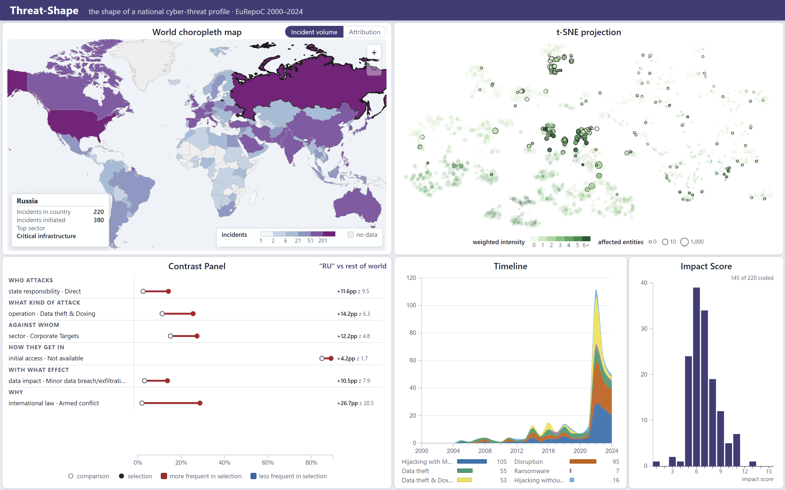
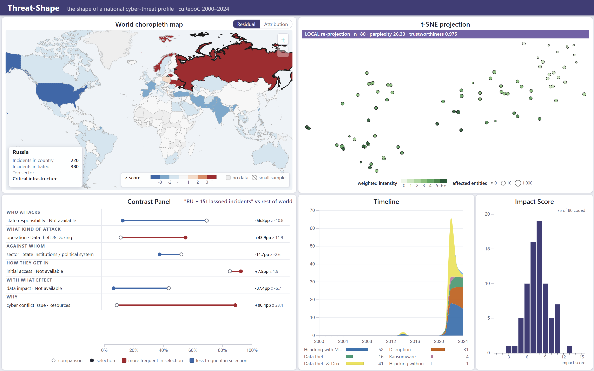
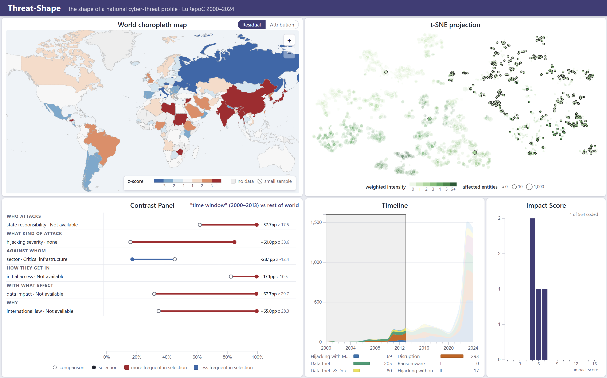
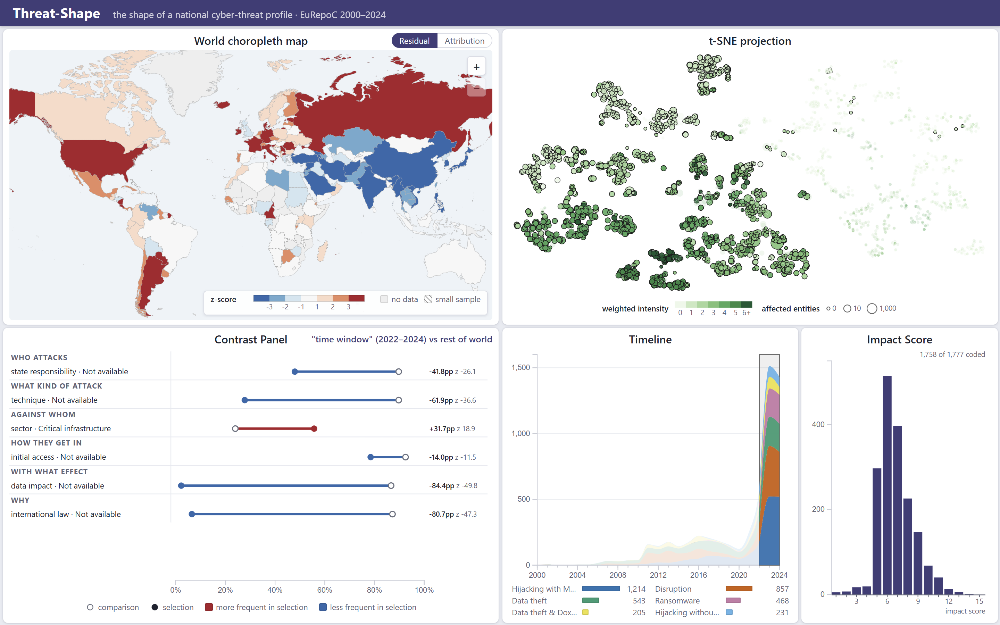
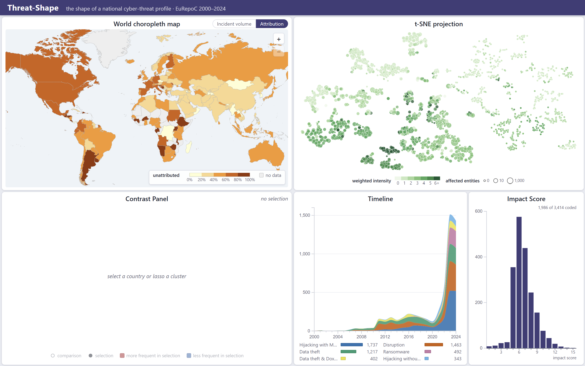
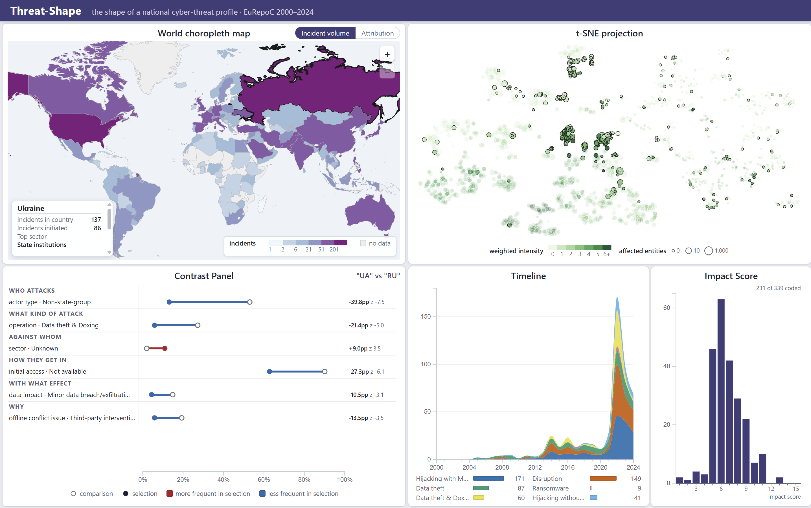
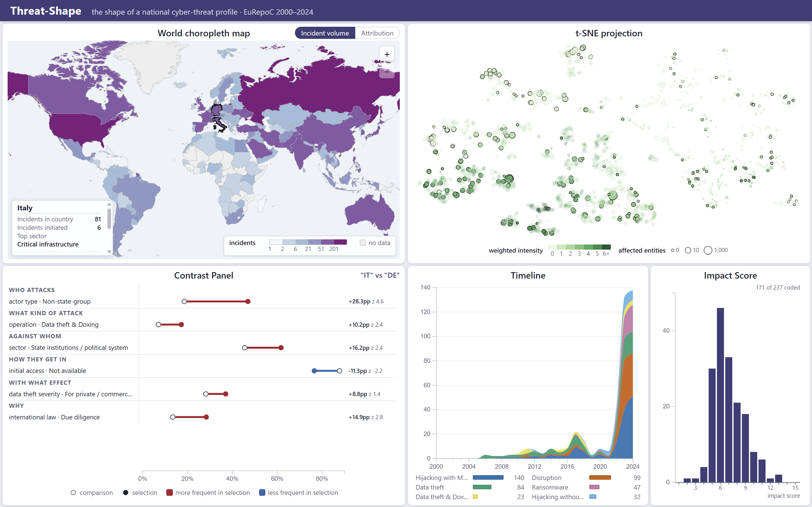

# Insights: what we found with Threat-Shape

Five findings on the EuRepoC corpus, 3,414 incidents from 2000 to 2024. We found all of
them with the tool, not by reading the CSVs.

We use the word "insight" narrowly. Something goes in this file only if all three of
these are true:

1. We reached it with a gesture the interface offers: a click or ctrl-click on the map,
   a lasso on the projection, a brush on the timeline.
2. One of the three analytics produced it. The standardized deviation, the local
   re-projection, or the contrastive z-scores.
3. It survives its own reliability test. Every number below carries its z. We treat
   |z| ≥ 2 as more than noise, and where we quote a number below that we say so.

**Reproducing the numbers.** `scripts/07_insights.py` recomputes every figure in this
file by calling the same endpoints the interface calls:

```bash
.venv/Scripts/python -m uvicorn backend.app.main:app     # in another terminal
.venv/Scripts/python scripts/07_insights.py
```

The script does one thing differently from us. A lasso is a hand gesture and cannot be
replayed exactly, so where we enclosed a cluster by hand the script recovers the same
incidents with DBSCAN over the published t-SNE coordinates (`eps=5`, `min_samples=10`).
It returns groups of 78 and 37, which are the two we lassoed in insight 1.

---

## Insight 1 — Russia as a target splits into two operational families

**What we did.** Clicked Russia on the map, looked at the projection, then lassoed each
of the two dense groups in turn.

**What we saw.** Russia's 220 incidents are not spread evenly across the projection.
They sit in two dense areas. Lassoing each one re-projects it on its own and recomputes
the contrast.

Two comparisons are in play here and they answer different questions, so we kept them
apart. On screen, a lasso compares the enclosed incidents with the rest of the world:
the upper group leads with `cyber conflict issue · International power` +82.8pp (z 13.0)
and the central group with `issue · Resources` +82.6pp (z 23.8). Both of those say "this
is war related", which separates each group from the corpus but not from each other. To
separate the two families we need the other Russian incidents as the comparison group,
which is the A-vs-B contrast below, computed by `scripts/07_insights.py`. The interface
reserves A-vs-B for exactly two selected countries.

| | Upper group | Central group |
|---|---|---|
| Incidents | 37 | 78 |
| Mean weighted intensity | **1.59** | **3.26** |
| Dominant types | Disruption (31) | Hijacking with Misuse (55), Data theft & Doxing (44) |
| Years | 2022 (22), 2023 (10), 2024 (5) | 2022 (40), 2023 (17), 2024 (15) |
| Strongest contrast vs other RU incidents | `downtime · Day` **+73.5pp** (z 10.8) · `data impact · no breach` +76.6pp (z 9.2) | `technique · Data Exfiltration` **+65.9pp** (z 10.0) · `offline issue · Territory` +68.4pp (z 9.8) |
| Local re-projection | n=37, perplexity 12.0, trustworthiness **0.938** | n=78, perplexity 25.7, trustworthiness **0.977** |

**What it means.** The upper group is denial of service: DDoS against banks, regional
networks and broadcasters, impact lasting a day, no data taken. The central group is
intrusion: data wiped on 800 servers, providers and state television breached,
exfiltration and doxing. Both start in 2022 and both are pro-Ukrainian.

What the two groups do not split on is the attacker. Ukraine's military intelligence
(HUR) and the volunteer groups (IT Army of Ukraine, Anonymous, Cyber Anarchy Squad, BO
Team) appear in both, and the share of incidents with no named initiator state is almost
the same, 38% against 40%. The projection separated them by what the operation does and
how deep it gets. For a defender that is the more useful cut, and grouping by actor would
never have produced it.

**Why we think it matters.** A dashboard built on counts reports 220 incidents against
Russia and stops there. These two groups differ by a factor of two in intensity and
describe two different adversaries, and an analyst writing a situational assessment needs
them apart. This is the case for the whole tool in one example: the shape of a profile
rather than its size.




The banner in that second figure reads n=80, perplexity 26.33, trustworthiness 0.975.
Our hand caught 80 incidents where DBSCAN recovers 78, which is the difference
between a gesture and a clustering rule. The trustworthiness is the same to two
decimals either way.

---

## Insight 2 — A contrast across time measures the codebook, not the threat

**What we did.** Brushed 2000–2013 on the timeline and read the contrast panel.

**What we saw.** The five strongest features of that window are these:

| Feature | Difference | z |
|---|---|---|
| `hijacking severity · none` | +69.0pp | 33.6 |
| `data impact · Not available` | +67.7pp | 29.7 |
| `downtime · Not available` | +67.5pp | 29.6 |
| `international law · Not available` | +65.0pp | 28.3 |
| `international law · Sovereignty` | −60.9pp | −26.5 |

Every one of them is about whether a field was filled in, not about what happened. (That
table is the flat ranking by |z|, as `scripts/07_insights.py` prints it. On screen the
panel shows the strongest one or two features per dimension, so the same "not available"
rows turn up under WHAT, HOW and WITH WHAT EFFECT.)

The coverage per year explains it:

| Year | n | `ilaw` not available | `downtime` not available | type occurrences per incident |
|---|---|---|---|---|
| 2013 | 147 | 100.0% | 100.0% | 1.21 |
| 2016 | 166 | 98.8% | 98.8% | 1.35 |
| 2019 | 91 | 86.8% | 85.7% | 1.71 |
| 2020 | 71 | 54.9% | 56.3% | 1.75 |
| 2022 | 354 | 16.7% | 12.1% | 1.62 |
| 2024 | 700 | 2.1% | 0.3% | 2.04 |

EuRepoC's coding depth changes sharply between 2019 and 2023. Two things move at the same
time: fields that were left empty start being filled, and the number of type labels
attached to one incident grows from 1.21 to 2.04. Part of the rise the timeline shows is
therefore growth in coding granularity rather than growth in the threat.

**The impact score says the same thing from another side.** EuRepoC scores the impact of
an incident from 0 to 15, and the score is 0 for 1,428 of the 3,414 incidents. We checked
what that zero means: all 1,428 of them have both the functional and the intelligence
impact field marked "not available". A zero is a missing value, not a harmless incident,
which is why the fifth card leaves those incidents out of the chart and reports them in
words above it. The share of zeros per year is 100.0% in 2013, 84.6% in 2019, 4.8% in
2022 and 0.1% in 2024. Brush the early years and the card reads "4 of 564 coded", with
almost nothing left to draw. Brush 2022 to 2024 and it reads "1,758 of 1,777 coded" with a
hump between 5 and 9. Over the whole corpus the mean of that column is 3.94, which falls
in the valley between its two modes and describes nobody.

**What an analyst has to do about it.** This is a finding about the data, produced by the
tool's own contrast panel, and it is also a trap the same panel sets. A brush that spans
the break answers a question about EuRepoC's editorial practice while looking like an
answer about cyber conflict. Our working rule is to brush inside the homogeneous era,
2022–2024, where the not-available share on these blocks is at most 17%, when we compare
characteristics, and to use the whole span only for volume.

The interface already states the weaker half of the caveat. View C's title tooltip warns
that the bands count type occurrences rather than incidents, which is why they sum to
about 1.7 times the incident count, and 2.1 times in 2023.




---

## Insight 3 — Attribution follows who attacks, not how good the victim is

**What we did.** Switched the map to the Attribution layer, read the two ends of the
scale, then clicked a country from each end and compared the contrast panels.

**What we saw.** Among the 27 countries with at least 45 recorded incidents, the share of
incidents with no named initiator state runs from 17% to 72%. These are the two ends:

| End of the scale | Countries |
|---|---|
| Below 30% unattributed | KR 17%, SA 21%, AE 24%, IN 25%, CN 27%, VN 29%, UA 30% |
| Above 55% unattributed | FR 72%, ES 68%, MX 65%, CA 62%, IT 62%, US 61%, DE 60%, CH 59%, AU 56%, BE 56% |

There is no gap between them. Ten countries sit in the middle, from Turkey at 31% to the
Netherlands at 49%, so this is a continuum and we are comparing its ends rather than two
separate populations. We say it because the map's colour scale makes the ends look like
two groups and they are not.

The contrast panel explains why the ends differ. Mean share of incidents whose initiator
is a state-affiliated actor:

| Group | Mean share |
|---|---|
| Countries below 30% unattributed | **45.2%** |
| Countries above 55% unattributed | **15.6%** |

**What it means.** The obvious explanation is that western states with mature CERTs
attribute better. It is the wrong way round: they attribute less often. What separates
the two ends is the adversary. Where the threat is dominated by state-affiliated
operations (Korea, the Gulf, India, Vietnam) a named initiator is part of the public
record. Where it is dominated by criminal and hacktivist activity (western Europe, North
America) most incidents never get a state attached to them, because there is no state to
attach.

**Caveat.** EuRepoC codes what is publicly reported, so this is a statement about the
public attribution record and not about classified attribution. The map's measure counts
"Not attributed" and "Unknown" together as no named initiator state.



---

## Insight 4 — Ukraine and Russia are mirror images, not two sides of one war

**What we did.** Clicked Ukraine, then ctrl-clicked Russia. Two countries selected puts
the panel into direct A-vs-B mode.

**What we saw.** n = 137 (UA) against 202 (RU):

| Feature | Ukraine | Russia | Difference | z |
|---|---|---|---|---|
| `actor type · Non-state-group` | 13.1% | **53.0%** | −39.8pp | −7.46 |
| `actor type · State affiliated actor` | **36.5%** | 10.4% | +26.1pp | 5.79 |
| `operation · Data theft & Doxing` | 5.8% | **27.2%** | −21.4pp | −4.97 |
| `initial access · Not available` | 62.8% | 90.1% | −27.3pp | −6.07 |
| `operation · Disruption` | 40.9% | 47.5% | −6.6pp | −1.21 (weak) |

**What it means.** The same war produces two different threat profiles. Ukraine is
attacked by states, with a named state-affiliated initiator in more than a third of its
incidents. Russia is attacked by volunteers, with non-state groups in more than half of
its incidents, and its attackers publish what they steal: doxing is nearly five times
more frequent against Russia than against Ukraine.

We left the last row in on purpose. The raw difference in Disruption looks readable, but
at z = −1.21 it rests on too few incidents to separate the two countries, and the panel
pushes it down the list accordingly.

**Caveat.** `initial access · Not available` at 90% on the Russian side says that how the
attackers got in is rarely documented for Russian targets. That is a coverage gap and we
report it, because leaving it out would suggest the access vectors are known.



---

## Insight 5 — Italy's threat profile is criminal where Germany's is anonymous

**What we did.** Clicked Italy, then ctrl-clicked Germany.

**Italy against the rest of the world** (n = 81 against 3,333):

| Feature | Difference | z | Italy | World |
|---|---|---|---|---|
| `sector · Critical infrastructure` | +21.7pp | 3.94 | 61.7% | 40.0% |
| `sector · Corporate Targets` | +19.2pp | 4.68 | 34.6% | 15.4% |
| `state responsibility · None/Negligent` | +16.4pp | 3.67 | 35.8% | 19.4% |
| `operation · Ransomware` | +12.8pp | 3.20 | 27.2% | 14.4% |

**Italy against Germany**, direct comparison (n = 81 against 156):

| Feature | Italy | Germany | Difference | z |
|---|---|---|---|---|
| `actor type · Non-state-group` | **46.9%** | 18.6% | +28.3pp | 4.59 |
| `actor type · Not attributed` | 25.9% | **49.4%** | −23.4pp | −3.47 |
| `state responsibility · None/Negligent` | 35.8% | 14.7% | +21.1pp | 3.72 |
| `sector · Corporate Targets` | 34.6% | 20.5% | +14.1pp | 2.36 |
| `operation · Ransomware` | 27.2% | 16.7% | +10.5pp | 1.91 (weak) |

**What it means.** Italy's incidents are attributed to identifiable non-state groups two
and a half times more often than Germany's, with no state held responsible, hitting
critical infrastructure and companies, often with ransomware. Half of Germany's are
attributed to nobody at all. For a CSIRT that is an operational difference: Italy's
profile points at criminal and hacktivist ecosystems that can be tracked by name,
Germany's points at a documentation gap.

We quote the ransomware row with its z of 1.91, below our threshold. On 81 against 156
incidents the direction is suggestive and no more. The same feature is established
against the rest of the world, at z 3.20, because there the comparison group is 3,333
incidents instead of 156.



---

## What the tool could not answer

We record these because the limits are part of the finding.

- **Initiators are not a map layer.** The map colours receivers. "Incidents initiated" is
  a number in the details panel, so we had to read the Ukraine and Russia mirror in the
  contrast panel instead of seeing it geographically.
- **No correction for multiple comparisons.** Each contrast tests 123 indicators at once,
  so an isolated |z| just above 2 among 123 is expected by chance. This is why the claims
  above lean on |z| > 3 and on features that agree with each other.
- **The panel shows a few features at a time.** It computes all 123 and draws the
  strongest one or two per dimension, which is between six and twelve rows. The rest are
  in the response and in the script's output, not on screen.
- **The corpus is a record of reporting.** Everything here describes publicly reported,
  manually coded incidents. Under-reporting by sector or by country is invisible to the
  tool, and insight 2 shows how strongly the coding practice can drive a result on its
  own.
- **Three or more countries.** With a bloc selected the panel compares the group against
  the rest of the world. There is no per-member breakdown, by design: the direct A-vs-B
  contrast is reserved for exactly two countries.

---

## Figures

The screenshots in `docs/img/` show the application in the state each insight describes.
Each one is the whole dashboard rather than a single view, because every finding depends
on several coordinated views answering at once.

| File | State on screen |
|---|---|
| `insight-1a-russia-two-clusters.png` | Russia clicked; the two dense groups of highlighted points in the projection are the subject |
| `insight-1b-russia-reprojected.png` | The same selection with the central group lassoed: purple `LOCAL re-projection` banner in the projection, contrast panel filled |
| `insight-2-coding-break.png` | The timeline brushed to 2000–2013, contrast panel leading with "Not available" features and the impact card nearly empty |
| `insight-2b-coding-break-recent.png` | The same brush moved to 2022–2024, for comparison: the impact card full, the "Not available" features gone |
| `insight-3-attribution-regimes.png` | The map on the attribution layer, no selection active |
| `insight-4-ukraine-russia.png` | Ukraine clicked and Russia ctrl-clicked, contrast panel header reading `"UA" vs "RU"` |
| `insight-5-italy-germany.png` | Italy clicked and Germany ctrl-clicked, header reading `"IT" vs "DE"` |
